# DOCUMENTACIÓN DEL SISTEMA DE GESTIÓN DE ENTRENAMIENTO PERSONAL

## FASE 1: INTRODUCCIÓN

### 1.1 Descripción del Sistema

El sistema de gestión de entrenamiento personal es una plataforma de software diseñada bajo una arquitectura de 3 capas (Presentación, Negocio y Datos). Su propósito principal es facilitar a los entrenadores personales la tarea de diseñar, organizar y asignar planes de entrenamiento y dietas personalizadas para sus clientes. El funcionamiento se basa en un principio fundamental: el entrenador asume el rol activo de diseño y asignación, mientras que el cliente tiene un rol pasivo, limitándose exclusivamente a consultar y consumir el plan asignado.

### 1.2 Problema

Actualmente, los entrenadores personales invierten una gran cantidad de tiempo organizando rutinas, ejercicios y dietas de forma manual o utilizando herramientas genéricas que no están integradas (hojas de cálculo, documentos de texto o mensajes sueltos). Esto genera:

- Desorganización en la asignación de rutinas.
- Dificultad para mantener un historial claro de lo que cada cliente debe realizar.
- Errores de comunicación al distribuir los planes (rutinas y dietas).
- Falta de un formato estandarizado y profesional para presentar la planificación a los clientes.

### 1.3 Justificación

El desarrollo de este sistema se justifica por la necesidad de centralizar y automatizar el flujo de trabajo del entrenador. Al contar con una herramienta estructurada, el profesional puede crear y reutilizar un catálogo de ejercicios, ensamblarlos en rutinas y acoplarlos con dietas para generar planes de entrenamiento completos. Esto no solo mejora la productividad y el orden del entrenador, sino que también ofrece un valor agregado al cliente, quien recibe sus planes de forma clara y accesible (por enlace web, PDF, correo o WhatsApp), mejorando la calidad del servicio ofrecido.

### 1.4 Objetivos

**Objetivo General**
Desarrollar un sistema de información web estructurado en una arquitectura de 3 capas que permita a los entrenadores personales diseñar, gestionar y distribuir planes de entrenamiento (rutinas y dietas) de forma centralizada y eficiente para sus clientes.

**Objetivos Específicos**

- Implementar un módulo de gestión que permita al entrenador registrar la información física y de contacto de sus clientes.
- Desarrollar un catálogo de ejercicios parametrizables (series, repeticiones, descansos, etc.) para la construcción de rutinas.
- Crear un gestor de dietas que permita elaborar y asignar planes alimenticios.
- Diseñar un módulo de creación de planes de entrenamiento que ensamble clientes, rutinas, dietas y periodos de tiempo.
- Desarrollar mecanismos de distribución que permitan exportar y compartir los planes generados mediante PDF, WhatsApp, correo electrónico y enlace de consulta.

### 1.5 Alcance

El proyecto abarca el análisis, diseño y documentación de la plataforma, cubriendo exclusivamente las siguientes funcionalidades:

- Autenticación y gestión de sesiones para entrenadores y clientes.
- CRUD (Crear, Leer, Actualizar, Eliminar) de clientes por parte del entrenador.
- CRUD de ejercicios, rutinas y dietas por parte del entrenador.
- Asignación de planes personalizados (cliente + rutina + dieta + fechas).
- Visualización de solo lectura para el cliente de la rutina y dieta asignada.
- Generación de documentos (PDF) y opciones para compartir (WhatsApp/Correo/Enlace).

**Fuera del alcance (Limitaciones del sistema):**

- El sistema **no** realizará control de asistencia ni validación del cumplimiento de los ejercicios por parte del cliente.
- **No** incluye seguimiento deportivo automático, ni registro progresivo de datos físicos (gráficos de peso o rendimiento a lo largo del tiempo).
- **No** contará con pasarela de pagos ni facturación.
- **No** incluirá Inteligencia Artificial para la creación automática de planes.
- **No** generará reportes avanzados de rendimiento deportivo.

---

## FASE 2: ANÁLISIS

### 2.1 Actores del Sistema

- **Entrenador (Actor Principal):** Es el usuario principal del sistema. Responsable de registrar clientes, crear rutinas, configurar ejercicios, crear dietas, generar los planes personalizados y asignarlos. También comparte los planes a través de PDF, correo, WhatsApp o enlaces.
- **Cliente (Actor Secundario):** Tiene un rol de solo lectura. Ingresa al sistema para consultar sus planes asignados, ver rutinas, ejercicios y dietas. No puede modificar ni crear información.

### 2.2 Requisitos Funcionales

| Código        | Requisito Funcional           | Descripción                                                                                                                       |
| -------------- | ----------------------------- | ---------------------------------------------------------------------------------------------------------------------------------- |
| **RF01** | Autenticación del entrenador | El sistema debe permitir al entrenador iniciar sesión mediante sus credenciales.                                                  |
| **RF02** | Gestión de clientes          | El sistema debe permitir registrar clientes con: Nombre, Correo, Teléfono, Peso, Altura, Sexo.                                    |
| **RF03** | Gestión de rutinas           | El sistema debe permitir crear, modificar y consultar rutinas (Nombre, Tipo, Ejercicios asociados).                                |
| **RF04** | Gestión de ejercicios        | El sistema debe permitir administrar ejercicios (Nombre, Duración, Imagen, Video, Repeticiones).                                  |
| **RF05** | Configuración de rutina      | El sistema debe permitir asociar ejercicios a una rutina, configurando: Series, Repeticiones, Descanso, Día de rutina, Duración. |
| **RF06** | Gestión de dietas            | El sistema debe permitir crear y consultar dietas (Título, Descripción).                                                         |
| **RF07** | Creación de planes           | El sistema debe permitir asociar a un Cliente una Rutina, una Dieta y establecer una Fecha de Inicio y Fecha de Fin.               |
| **RF08** | Consulta del cliente          | El sistema debe permitir al cliente visualizar la información que le ha sido asignada.                                            |
| **RF09** | Compartir plan                | El sistema debe permitir generar mecanismos de distribución (PDF, Correo electrónico, WhatsApp, Enlace de consulta).             |

### 2.3 Requisitos No Funcionales

| Código         | Requisito No Funcional | Descripción                                                                                  |
| --------------- | ---------------------- | --------------------------------------------------------------------------------------------- |
| **RNF01** | Usabilidad             | Interfaces simples e intuitivas para el entrenador y el cliente, desde cualquier dispositivo. |
| **RNF02** | Seguridad              | Protección de credenciales y control de acceso según el tipo de usuario.                    |
| **RNF03** | Rendimiento            | Respuestas eficientes en operaciones comunes como consultar planes, rutinas o clientes.       |
| **RNF04** | Mantenibilidad         | El código debe estar organizado bajo la arquitectura de 3 capas.                             |
| **RNF05** | Escalabilidad          | Capacidad para soportar un mayor número de clientes, entrenadores y rutinas.                 |
| **RNF06** | Disponibilidad         | Acceso continuo a la información en cualquier momento.                                       |
| **RNF07** | Integridad de datos    | Relaciones correctas, validación de claves foráneas y prevención de inconsistencias.       |
| **RNF08** | Portabilidad           | Ejecución estable en diferentes entornos y servidores.                                       |

### 2.4 Modelo de Negocio

El flujo principal del negocio se resume en los siguientes pasos secuenciales:

1. El entrenador registra los datos de sus clientes.
2. El entrenador diseña rutinas de entrenamiento a partir de un catálogo de ejercicios.
3. El entrenador diseña dietas.
4. El entrenador genera un "Plan de Entrenamiento" uniendo un Cliente, una Rutina y una Dieta en un periodo específico (fecha de inicio y fin).
5. El cliente accede a consultar el plan que le ha sido asignado.

### 2.5 Casos de Uso Principales

#### 2.5.1 Diagrama General de Casos de Uso

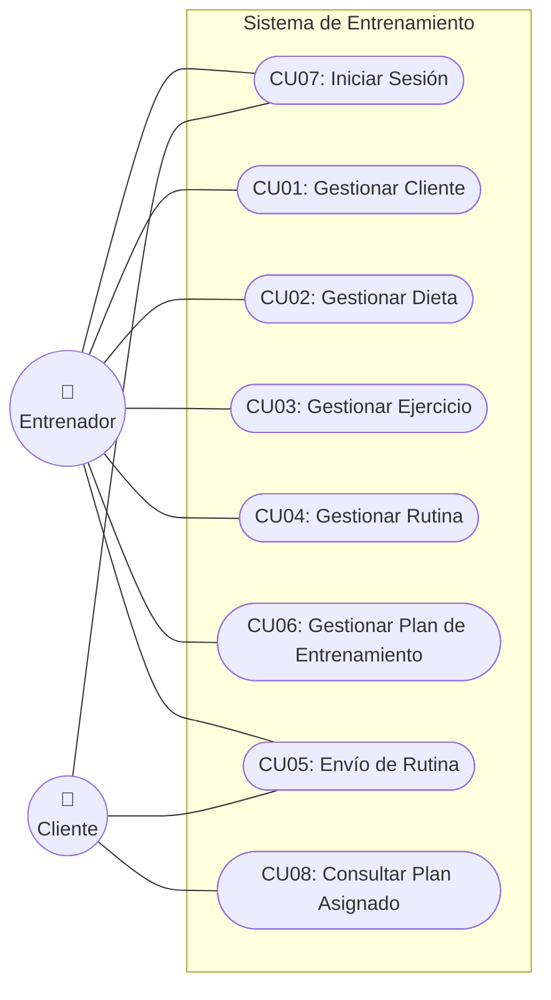

#### 2.5.2 Detalle de Casos de Uso

A continuación se detallan los 8 casos de uso principales. Para modelar estos diagramas individuales en **Enterprise Architect (EA)** o cualquier herramienta UML, debes:

1. Crear un **Actor** (ej. Entrenador).
2. Crear un **Use Case** (óvalo).
3. Conectar el Actor al Use Case mediante una **Association** (línea sólida).

#### CU01: Gestionar Cliente

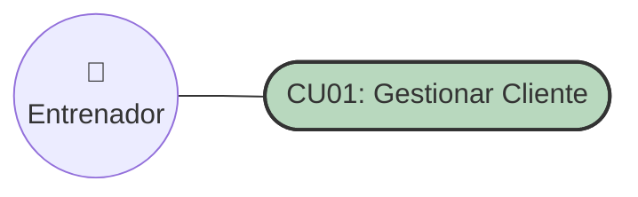

| Campo                     | Detalle                                                                                                                                                                                                                                                                                                                     |
| :------------------------ | :-------------------------------------------------------------------------------------------------------------------------------------------------------------------------------------------------------------------------------------------------------------------------------------------------------------------------- |
| **Caso de uso**     | **CU01: Gestionar Cliente**                                                                                                                                                                                                                                                                                           |
| **Propósito**      | Gestionar la información de los clientes.                                                                                                                                                                                                                                                                                  |
| **Descripción**    | Permitirá registrar, actualizar y eliminar la información de los clientes del entrenador.                                                                                                                                                                                                                                 |
| **Actores**         | Entrenador                                                                                                                                                                                                                                                                                                                  |
| **Actor Iniciador** | Entrenador                                                                                                                                                                                                                                                                                                                  |
| **Precondición**   | Ninguna.                                                                                                                                                                                                                                                                                                                    |
| **Proceso**         | 1. El sistema muestra la lista de clientes registrados.2. El entrenador selecciona la opción de agregar, modificar o eliminar un cliente.3. El entrenador ingresa o edita la información del cliente.4. El sistema valida y guarda los cambios.5. El entrenador puede eliminar la información de un cliente si lo desea. |
| **Postcondición**  | La información de los clientes se actualiza en el sistema.                                                                                                                                                                                                                                                                 |
| **Excepción**      | Validar entradas vacías. En caso de error, mostrar el mensaje correspondiente.                                                                                                                                                                                                                                             |

#### CU02: Gestionar Dieta

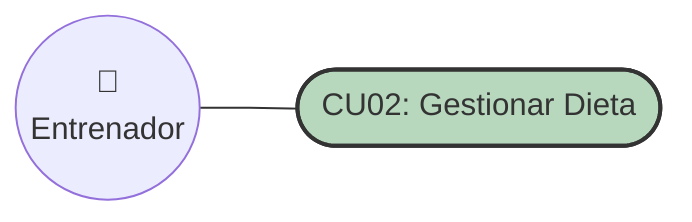

| Campo                     | Detalle                                                                                                                                                                                                                                                                                                                 |
| :------------------------ | :---------------------------------------------------------------------------------------------------------------------------------------------------------------------------------------------------------------------------------------------------------------------------------------------------------------------- |
| **Caso de uso**     | **CU02: Gestionar Dieta**                                                                                                                                                                                                                                                                                         |
| **Propósito**      | Administrar los planes de dieta asignados a las rutinas de los clientes.                                                                                                                                                                                                                                                |
| **Descripción**    | Permitirá crear, modificar y eliminar los planes de dieta asociados a cada rutina.                                                                                                                                                                                                                                     |
| **Actores**         | Entrenador                                                                                                                                                                                                                                                                                                              |
| **Actor Iniciador** | Entrenador                                                                                                                                                                                                                                                                                                              |
| **Precondición**   | Ninguna.                                                                                                                                                                                                                                                                                                                |
| **Proceso**         | 1. El sistema muestra la lista de dietas registradas.2. El entrenador selecciona la opción de agregar, modificar o eliminar una dieta.3. El entrenador ingresa o edita la información de la dieta.4. El sistema valida y guarda los cambios.5. El entrenador puede eliminar la información de una dieta si lo desea. |
| **Postcondición**  | La información de las dietas se actualiza en el sistema.                                                                                                                                                                                                                                                               |
| **Excepción**      | Validar entradas vacías. En caso de error, mostrar el mensaje correspondiente.                                                                                                                                                                                                                                         |

#### CU03: Gestionar Ejercicio

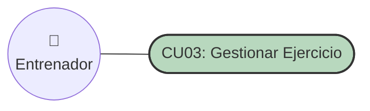

| Campo                     | Detalle                                                                                                                                                                                                                                                                                                  |
| :------------------------ | :------------------------------------------------------------------------------------------------------------------------------------------------------------------------------------------------------------------------------------------------------------------------------------------------------- |
| **Caso de uso**     | **CU03: Gestionar Ejercicio**                                                                                                                                                                                                                                                                      |
| **Propósito**      | Administrar los ejercicios para las rutinas.                                                                                                                                                                                                                                                             |
| **Descripción**    | Permite agregar, modificar o eliminar ejercicios dentro de las rutinas.                                                                                                                                                                                                                                  |
| **Actores**         | Entrenador                                                                                                                                                                                                                                                                                               |
| **Actor Iniciador** | Entrenador                                                                                                                                                                                                                                                                                               |
| **Precondición**   | Ninguna.                                                                                                                                                                                                                                                                                                 |
| **Proceso**         | 1. El sistema muestra la lista de ejercicios disponibles.2. El entrenador selecciona la opción de agregar, modificar o eliminar un ejercicio.3. El entrenador ingresa la información del ejercicio.4. El sistema valida y guarda los cambios.5. El entrenador puede eliminar un ejercicio de la lista. |
| **Postcondición**  | Los ejercicios se actualizan y pueden vincularse a las rutinas.                                                                                                                                                                                                                                          |
| **Excepción**      | Validar entradas vacías. En caso de error, mostrar el mensaje correspondiente.                                                                                                                                                                                                                          |

#### CU04: Gestionar Rutina

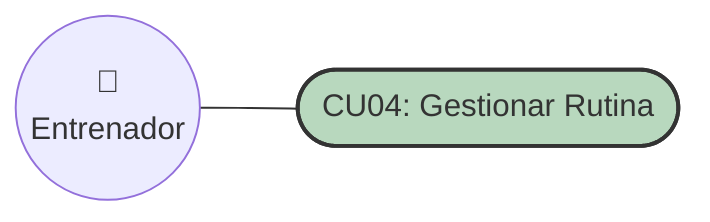

| Campo                     | Detalle                                                                                                                                                                                                                                                                                                                                       |
| :------------------------ | :-------------------------------------------------------------------------------------------------------------------------------------------------------------------------------------------------------------------------------------------------------------------------------------------------------------------------------------------- |
| **Caso de uso**     | **CU04: Gestionar Rutina de Entrenamiento**                                                                                                                                                                                                                                                                                             |
| **Propósito**      | Administrar las rutinas de entrenamiento para los clientes.                                                                                                                                                                                                                                                                                   |
| **Descripción**    | Permitirá crear, actualizar y eliminar las rutinas de entrenamiento asignadas a cada cliente.                                                                                                                                                                                                                                                |
| **Actores**         | Entrenador                                                                                                                                                                                                                                                                                                                                    |
| **Actor Iniciador** | Entrenador                                                                                                                                                                                                                                                                                                                                    |
| **Precondición**   | Deben existir clientes y ejercicios/dietas registrados previamente.                                                                                                                                                                                                                                                                           |
| **Proceso**         | 1. El sistema verifica si hay clientes y dietas registrados (sino, muestra advertencia).2. El sistema muestra una lista de rutinas existentes.3. El entrenador selecciona agregar, modificar o eliminar una rutina.4. El entrenador ingresa la información de la rutina y asigna el cliente/dieta.5. El sistema valida y guarda los cambios. |
| **Postcondición**  | Las rutinas se actualizan y están listas para consumirse.                                                                                                                                                                                                                                                                                    |
| **Excepción**      | Validar que la rutina contenga al menos un cliente y una dieta.                                                                                                                                                                                                                                                                               |

#### CU05: Asignar y Enviar Plan

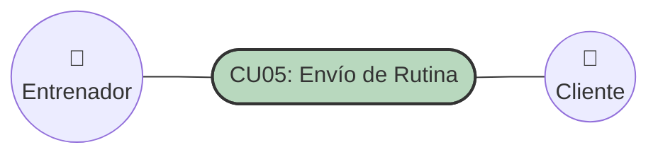

| Campo                     | Detalle                                                                                                                        |
| :------------------------ | :----------------------------------------------------------------------------------------------------------------------------- |
| **Caso de uso**     | **CU05: Envío de Rutina de Entrenamiento**                                                                              |
| **Propósito**      | Enviar la rutina de entrenamiento y la dieta al cliente.                                                                       |
| **Descripción**    | Permitirá generar y enviar un PDF con la rutina y el plan de dieta asignados al cliente a través de WhatsApp o correo.       |
| **Actores**         | Entrenador, Cliente                                                                                                            |
| **Actor Iniciador** | Entrenador                                                                                                                     |
| **Precondición**   | La rutina y dieta deben estar previamente creadas y asignadas al cliente.                                                      |
| **Proceso**         |                                                                                                                                |
| **Postcondición**  | El cliente recibe correctamente la rutina en formato PDF.                                                                      |
| **Excepción**      | Validar que el cliente tenga un número de WhatsApp o correo registrado. En caso de error, mostrar un mensaje correspondiente. |

#### CU06: Gestionar Plan de Entrenamiento

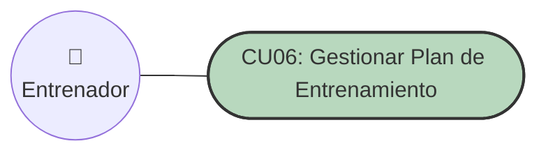

| Campo                     | Detalle                                                                                                                                                                                                                                                                                 |
| :------------------------ | :-------------------------------------------------------------------------------------------------------------------------------------------------------------------------------------------------------------------------------------------------------------------------------------- |
| **Caso de uso**     | **CU06: Gestionar Plan de Entrenamiento**                                                                                                                                                                                                                                         |
| **Propósito**      | Crear un plan completo y personalizado para un cliente.                                                                                                                                                                                                                                 |
| **Descripción**    | Permite asignar una Rutina y una Dieta a un Cliente específico, definiendo las fechas de inicio y fin del plan.                                                                                                                                                                        |
| **Actores**         | Entrenador                                                                                                                                                                                                                                                                              |
| **Actor Iniciador** | Entrenador                                                                                                                                                                                                                                                                              |
| **Precondición**   | Deben existir clientes, rutinas y dietas creados previamente en el sistema.                                                                                                                                                                                                             |
| **Proceso**         | 1. El sistema muestra la pantalla de gestión de planes.2. El entrenador selecciona un Cliente.3. El entrenador selecciona una Rutina.4. El entrenador selecciona una Dieta.5. El entrenador ingresa la Fecha de Inicio y Fecha de Fin.6. El sistema valida los datos y guarda el plan. |
| **Postcondición**  | El plan de entrenamiento se guarda y queda disponible para el cliente.                                                                                                                                                                                                                  |
| **Excepción**      | Validar que no existan campos vacíos ni fechas incongruentes (fecha fin anterior a fecha inicio).                                                                                                                                                                                      |

#### CU07: Iniciar Sesión

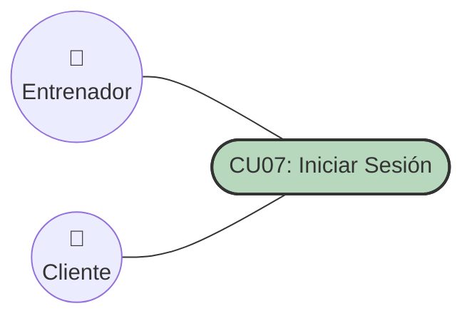

| Campo                     | Detalle                                                                                                                                                                                                                                                                          |
| :------------------------ | :------------------------------------------------------------------------------------------------------------------------------------------------------------------------------------------------------------------------------------------------------------------------------- |
| **Caso de uso**     | **CU07: Iniciar Sesión**                                                                                                                                                                                                                                                  |
| **Propósito**      | Autenticar a los usuarios para acceder al sistema.                                                                                                                                                                                                                               |
| **Descripción**    | Permite validar las credenciales del entrenador o cliente para otorgar acceso a sus respectivos paneles.                                                                                                                                                                         |
| **Actores**         | Entrenador, Cliente                                                                                                                                                                                                                                                              |
| **Actor Iniciador** | Entrenador o Cliente                                                                                                                                                                                                                                                             |
| **Precondición**   | El usuario debe estar previamente registrado en la base de datos.                                                                                                                                                                                                                |
| **Proceso**         | 1. El sistema muestra el formulario de inicio de sesión.2. El usuario ingresa su correo electrónico y contraseña.3. El sistema valida las credenciales en la base de datos.4. Si es Entrenador, redirige al panel de gestión; si es Cliente, redirige a la vista de su plan. |
| **Postcondición**  | El usuario accede a su sesión iniciada.                                                                                                                                                                                                                                         |
| **Excepción**      | Si las credenciales son incorrectas, mostrar mensaje de error ("Usuario o contraseña inválidos").                                                                                                                                                                              |

#### CU08: Consultar Plan Asignado

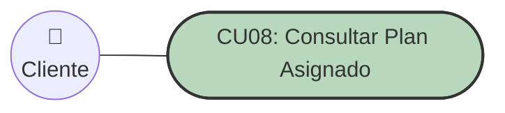

| Campo                     | Detalle                                                                                                                                                                                                                                             |
| :------------------------ | :-------------------------------------------------------------------------------------------------------------------------------------------------------------------------------------------------------------------------------------------------- |
| **Caso de uso**     | **CU08: Consultar Plan Asignado**                                                                                                                                                                                                             |
| **Propósito**      | Permitir al cliente ver su plan de entrenamiento actual.                                                                                                                                                                                            |
| **Descripción**    | El cliente visualiza de forma interactiva (solo lectura) la rutina, los ejercicios y la dieta que el entrenador le asignó para el periodo actual.                                                                                                  |
| **Actores**         | Cliente                                                                                                                                                                                                                                             |
| **Actor Iniciador** | Cliente                                                                                                                                                                                                                                             |
| **Precondición**   | El cliente debe haber iniciado sesión y tener un plan vigente asignado.                                                                                                                                                                            |
| **Proceso**         | 1. El cliente accede a la opción "Mi Plan".2. El sistema busca el plan activo asignado a este cliente.3. El sistema muestra la Rutina, los Ejercicios (series, repeticiones) y la Dieta correspondientes.4. El cliente navega por la información. |
| **Postcondición**  | El cliente se informa de su plan a realizar.                                                                                                                                                                                                        |
| **Excepción**      | Si el cliente no tiene un plan activo, el sistema muestra un mensaje indicando que no hay planes asignados en este momento.                                                                                                                         |

### 2.6 Identificación de Módulos

#### 2.6.1 Identificar Módulos

**Módulo de Seguridad**

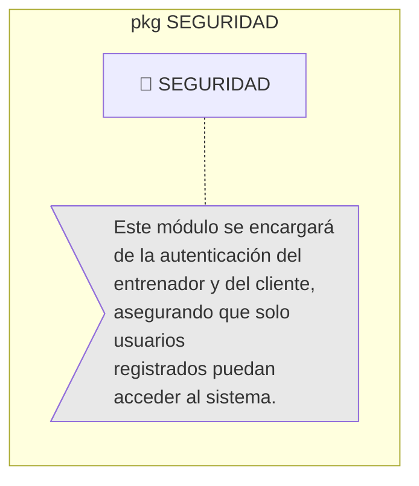

**Módulo Cliente**

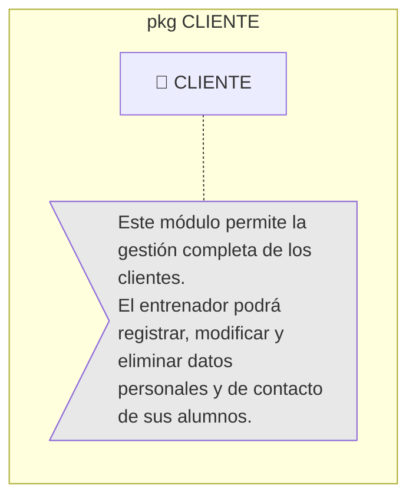

**Módulo Entrenamiento**

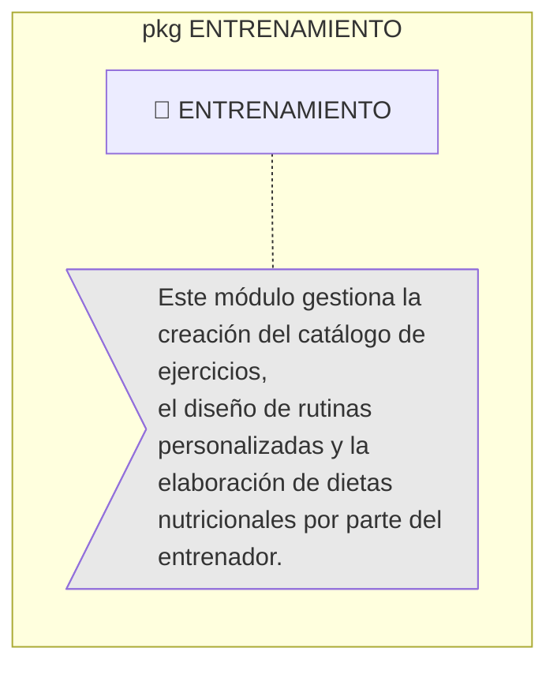

**Módulo Gestión y Envío de Planes**

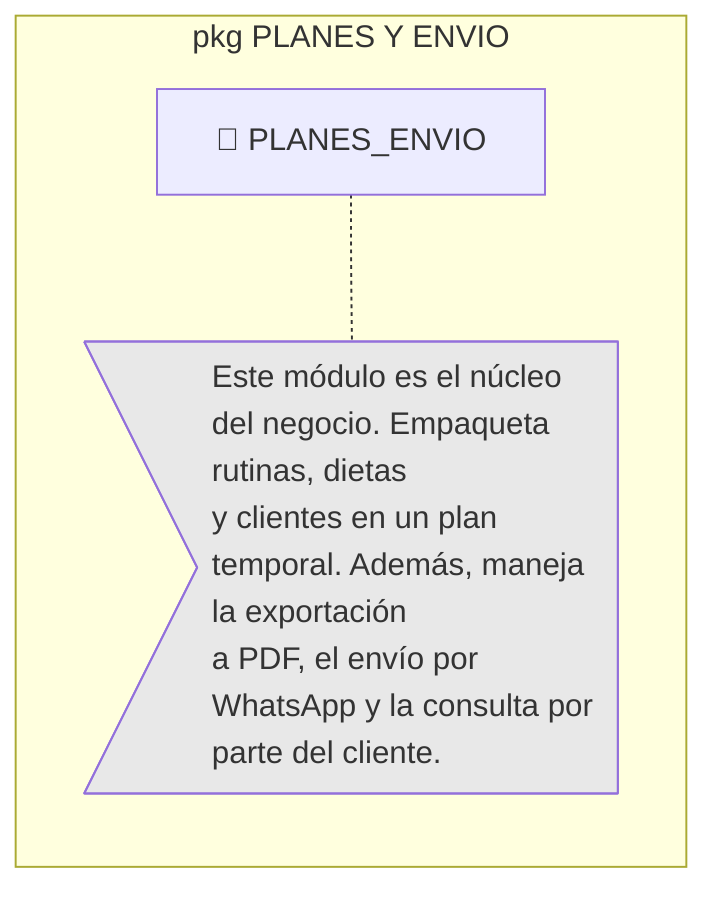

#### 2.6.2 Vista de Módulos

**Módulo de Seguridad**

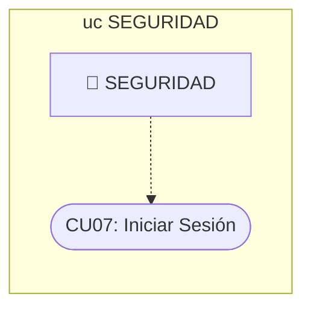

**Módulo Cliente**

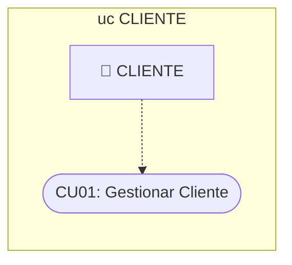

**Módulo Entrenamiento**

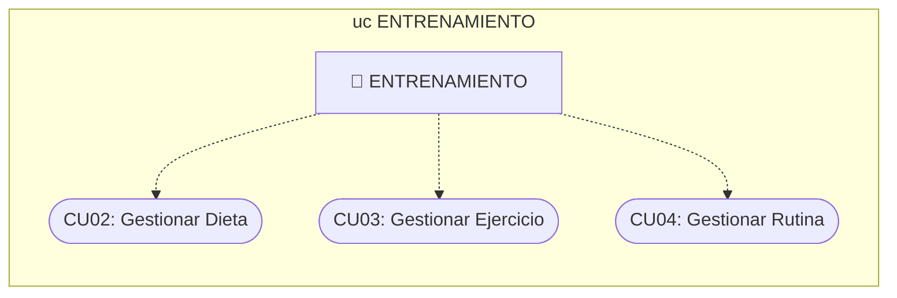

**Módulo Gestión y Envío de Planes**

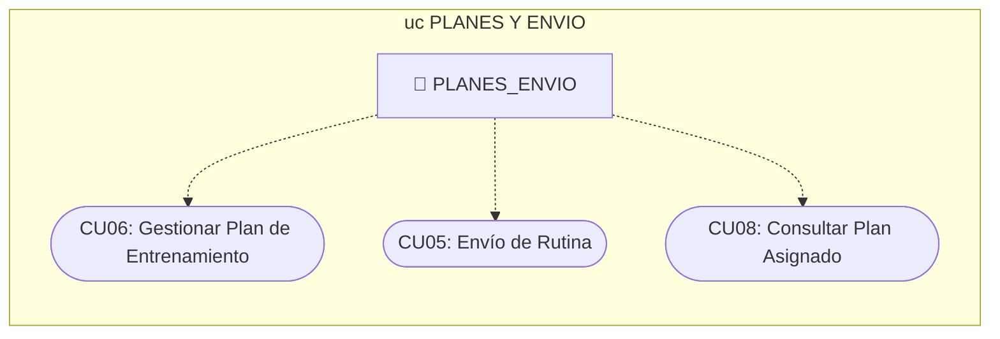

---

## FASE 3: DISEÑO CONCEPTUAL

### 3.1 Modelo Conceptual (Diagrama UML de Clases)

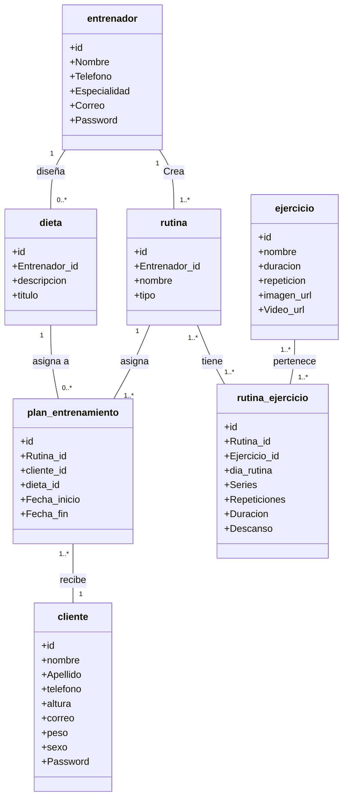

### 3.2 Entidades y Responsabilidades

| Entidad                      | Responsabilidad Principal                                                                                      |
| ---------------------------- | -------------------------------------------------------------------------------------------------------------- |
| **entrenador**         | Representa al profesional que interactúa con el sistema para diseñar y administrar los planes.               |
| **cliente**            | Persona que recibe los planes. Su información física y de contacto es registrada por el entrenador.          |
| **rutina**             | Actúa como una plantilla de entrenamiento que agrupa varios ejercicios de un mismo tipo o propósito.         |
| **ejercicio**          | Catálogo general de ejercicios disponibles con su información multimedia y de ejecución base.               |
| **rutina_ejercicio**   | Tabla intermedia que configura y personaliza un ejercicio específico dentro de una rutina (series, descanso). |
| **dieta**              | Plan alimenticio creado por el entrenador, compuesto por un título y su respectiva descripción.              |
| **plan_entrenamiento** | Entidad central que vincula a un Cliente específico con una Rutina (y dieta) para un periodo de tiempo.       |

### 3.3 Relaciones y Cardinalidades

- **entrenador 1 ---- 0..* dieta**: Un entrenador diseña múltiples dietas.
- **entrenador 1 ---- 1..* rutina**: Un entrenador crea múltiples rutinas.
- **rutina 1..* ---- 1..* ejercicio**: Relación muchos a muchos resuelta por la tabla **rutina_ejercicio**.
- **rutina 1 ---- 1..* plan_entrenamiento**: Una rutina se asigna a múltiples planes de entrenamiento.
- **dieta 1 ---- 0..* plan_entrenamiento**: Una dieta se puede asignar a múltiples planes.
- **plan_entrenamiento 1..* ---- 1 cliente**: Múltiples planes son recibidos por un cliente a lo largo del tiempo.

---

## FASE 4: DISEÑO LÓGICO

A continuación se presenta el diseño lógico de la base de datos alineado estrictamente con el Modelo Conceptual proporcionado.

### 4.1 Modelo Relacional (Tablas)

<br>

<table border="1" style="border-collapse: collapse; width: 100%; text-align: left;">
    <tr style="background-color: #b89f66;"><th colspan="7" style="text-align: center; padding: 5px;">entrenador</th></tr>
    <tr>
        <td style="padding: 5px;"><b>pk</b></td>
        <td></td><td></td><td></td><td></td><td></td><td></td>
    </tr>
    <tr>
        <td style="padding: 5px;"><u>id</u></td>
        <td style="padding: 5px;">Nombre</td>
        <td style="padding: 5px;">Telefono</td>
        <td style="padding: 5px;">Especialidad</td>
        <td style="padding: 5px;">Correo</td>
        <td style="padding: 5px;">Password</td>
    </tr>
</table>

<br>

<table border="1" style="border-collapse: collapse; width: 100%; text-align: left;">
    <tr style="background-color: #b89f66;"><th colspan="9" style="text-align: center; padding: 5px;">cliente</th></tr>
    <tr>
        <td style="padding: 5px;"><b>pk</b></td>
        <td></td><td></td><td></td><td></td><td></td><td></td><td></td><td></td>
    </tr>
    <tr>
        <td style="padding: 5px;"><u>id</u></td>
        <td style="padding: 5px;">nombre</td>
        <td style="padding: 5px;">Apellido</td>
        <td style="padding: 5px;">telefono</td>
        <td style="padding: 5px;">altura</td>
        <td style="padding: 5px;">correo</td>
        <td style="padding: 5px;">peso</td>
        <td style="padding: 5px;">sexo</td>
        <td style="padding: 5px;">Password</td>
    </tr>
</table>

<br>

<table border="1" style="border-collapse: collapse; width: 100%; text-align: left;">
    <tr style="background-color: #b89f66;"><th colspan="4" style="text-align: center; padding: 5px;">dieta</th></tr>
    <tr>
        <td style="padding: 5px;"><b>pk</b></td>
        <td style="padding: 5px;"><b>fk</b></td>
        <td></td><td></td>
    </tr>
    <tr>
        <td style="padding: 5px;"><u>id</u></td>
        <td style="padding: 5px;">Entrenador_id</td>
        <td style="padding: 5px;">descripcion</td>
        <td style="padding: 5px;">titulo</td>
    </tr>
</table>

<br>

<table border="1" style="border-collapse: collapse; width: 100%; text-align: left;">
    <tr style="background-color: #b89f66;"><th colspan="4" style="text-align: center; padding: 5px;">rutina</th></tr>
    <tr>
        <td style="padding: 5px;"><b>pk</b></td>
        <td style="padding: 5px;"><b>fk</b></td>
        <td></td><td></td>
    </tr>
    <tr>
        <td style="padding: 5px;"><u>id</u></td>
        <td style="padding: 5px;">Entrenador_id</td>
        <td style="padding: 5px;">nombre</td>
        <td style="padding: 5px;">tipo</td>
    </tr>
</table>

<br>

<table border="1" style="border-collapse: collapse; width: 100%; text-align: left;">
    <tr style="background-color: #b89f66;"><th colspan="6" style="text-align: center; padding: 5px;">ejercicio</th></tr>
    <tr>
        <td style="padding: 5px;"><b>pk</b></td>
        <td></td><td></td><td></td><td></td><td></td>
    </tr>
    <tr>
        <td style="padding: 5px;"><u>id</u></td>
        <td style="padding: 5px;">nombre</td>
        <td style="padding: 5px;">duracion</td>
        <td style="padding: 5px;">repeticion</td>
        <td style="padding: 5px;">imagen_url</td>
        <td style="padding: 5px;">Video_url</td>
    </tr>
</table>

<br>

<table border="1" style="border-collapse: collapse; width: 100%; text-align: left;">
    <tr style="background-color: #b89f66;"><th colspan="8" style="text-align: center; padding: 5px;">rutina_ejercicio</th></tr>
    <tr>
        <td style="padding: 5px;"><b>pk</b></td>
        <td style="padding: 5px;"><b>fk</b></td>
        <td style="padding: 5px;"><b>fk</b></td>
        <td></td><td></td><td></td><td></td><td></td>
    </tr>
    <tr>
        <td style="padding: 5px;"><u>id</u></td>
        <td style="padding: 5px;">Rutina_id</td>
        <td style="padding: 5px;">Ejercicio_id</td>
        <td style="padding: 5px;">dia_rutina</td>
        <td style="padding: 5px;">Series</td>
        <td style="padding: 5px;">Repeticiones</td>
        <td style="padding: 5px;">Duracion</td>
        <td style="padding: 5px;">Descanso</td>
    </tr>
</table>

<br>

<table border="1" style="border-collapse: collapse; width: 100%; text-align: left;">
    <tr style="background-color: #b89f66;"><th colspan="6" style="text-align: center; padding: 5px;">plan_entrenamiento</th></tr>
    <tr>
        <td style="padding: 5px;"><b>pk</b></td>
        <td style="padding: 5px;"><b>fk</b></td>
        <td style="padding: 5px;"><b>fk</b></td>
        <td style="padding: 5px;"><b>fk</b></td>
        <td></td><td></td>
    </tr>
    <tr>
        <td style="padding: 5px;"><u>id</u></td>
        <td style="padding: 5px;">Rutina_id</td>
        <td style="padding: 5px;">cliente_id</td>
        <td style="padding: 5px;">dieta_id</td>
        <td style="padding: 5px;">Fecha_inicio</td>
        <td style="padding: 5px;">Fecha_fin</td>
    </tr>
</table>

### 4.2 Script de Base de Datos (Diseño Físico)

```sql
-- ============================================================
-- BASE DE DATOS: Noel-Arqui-GYM
-- Sistema: Personal Training — Arquitectura 3 Capas
-- Motor: PostgreSQL
-- ============================================================

CREATE TABLE entrenador (
    id SERIAL PRIMARY KEY,
    Nombre VARCHAR(100) NOT NULL,
    Telefono VARCHAR(20) NOT NULL,
    Especialidad VARCHAR(100) NOT NULL,
    Correo VARCHAR(150) NOT NULL UNIQUE,
    Password VARCHAR(255) NOT NULL
);

CREATE TABLE cliente (
    id SERIAL PRIMARY KEY,
    nombre VARCHAR(100) NOT NULL,
    Apellido VARCHAR(100) NOT NULL,
    telefono VARCHAR(20) NOT NULL,
    altura NUMERIC(4,2) NOT NULL,
    correo VARCHAR(150) NOT NULL UNIQUE,
    peso NUMERIC(5,2) NOT NULL,
    sexo CHAR(1) NOT NULL CHECK (sexo IN ('M', 'F', 'O')),
    Password VARCHAR(255) NOT NULL
);

CREATE TABLE dieta (
    id SERIAL PRIMARY KEY,
    Entrenador_id INTEGER NOT NULL REFERENCES entrenador(id) ON DELETE CASCADE,
    descripcion TEXT NOT NULL,
    titulo VARCHAR(150) NOT NULL
);

CREATE TABLE rutina (
    id SERIAL PRIMARY KEY,
    Entrenador_id INTEGER NOT NULL REFERENCES entrenador(id) ON DELETE CASCADE,
    nombre VARCHAR(150) NOT NULL,
    tipo VARCHAR(80) NOT NULL
);

CREATE TABLE ejercicio (
    id SERIAL PRIMARY KEY,
    nombre VARCHAR(150) NOT NULL,
    duracion VARCHAR(50) NOT NULL,
    repeticion VARCHAR(50) NOT NULL,
    imagen_url TEXT,
    Video_url TEXT
);

CREATE TABLE rutina_ejercicio (
    id SERIAL PRIMARY KEY,
    Rutina_id INTEGER NOT NULL REFERENCES rutina(id) ON DELETE CASCADE,
    Ejercicio_id INTEGER NOT NULL REFERENCES ejercicio(id) ON DELETE CASCADE,
    dia_rutina VARCHAR(20) NOT NULL,
    Series INTEGER NOT NULL,
    Repeticiones INTEGER NOT NULL,
    Duracion INTEGER NOT NULL,
    Descanso INTEGER NOT NULL
);

CREATE TABLE plan_entrenamiento (
    id SERIAL PRIMARY KEY,
    Rutina_id INTEGER NOT NULL REFERENCES rutina(id) ON DELETE CASCADE,
    cliente_id INTEGER NOT NULL REFERENCES cliente(id) ON DELETE CASCADE,
    dieta_id INTEGER NOT NULL REFERENCES dieta(id) ON DELETE CASCADE,
    Fecha_inicio DATE NOT NULL,
    Fecha_fin DATE NOT NULL,
    CONSTRAINT chk_fechas CHECK (Fecha_fin >= Fecha_inicio)
);
```

---

## FASE 5: DISEÑO ARQUITECTÓNICO

En esta fase se documenta la estructura tecnológica del sistema siguiendo el patrón de **Arquitectura de 3 Capas** (Presentación, Negocio y Datos). El objetivo de esta arquitectura es separar las responsabilidades, facilitando el mantenimiento, la escalabilidad y garantizando que los flujos de información (como la generación de planes de entrenamiento) pasen por validaciones estrictas antes de llegar a la base de datos.

### 5.1 Diagrama de Paquetes en Capas

El siguiente diagrama de paquetes organiza los módulos funcionales descubiertos en la Fase 2, distribuyéndolos físicamente dentro de la arquitectura de 3 capas.

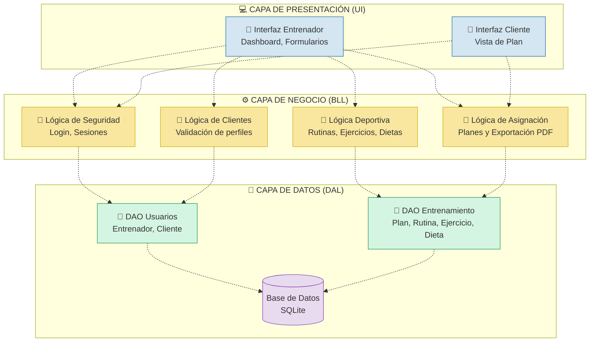

### 5.2 Descripción de las Capas

#### 1. Capa de Presentación (UI - User Interface)

Es la capa más externa, responsable de interactuar directamente con el Entrenador y el Cliente.

- **Responsabilidad:** Capturar las entradas del usuario (ej. crear una rutina) y mostrar los resultados (ej. renderizar el PDF del plan).
- **Restricción:** No contiene reglas de negocio. Solo se comunica con la Capa de Negocio.

#### 2. Capa de Negocio (BLL - Business Logic Layer)

Es el "cerebro" del sistema. Aquí residen todos los módulos funcionales identificados en la Fase 2.

- **Responsabilidad:** Validar las reglas del negocio. Por ejemplo, asegura que no se pueda asignar un plan a un cliente inexistente, o calcula que la "fecha fin" de un plan sea mayor a la "fecha inicio".
- **Restricción:** Actúa como puente. Recibe peticiones de la UI, las procesa, y solicita información a la Capa de Datos.

#### 3. Capa de Datos (DAL - Data Access Layer)

Es la capa encargada de la persistencia de la información.

- **Responsabilidad:** Ejecutar las consultas SQL (`INSERT`, `SELECT`, `UPDATE`, `DELETE`) directamente sobre la base de datos relacional (SQLite) basándose en las entidades (Entrenador, Cliente, Rutina, etc.).
- **Restricción:** Solo es accesible por la Capa de Negocio. La interfaz de usuario jamás toca la base de datos directamente, garantizando la seguridad del sistema.

---

## FASE 6: DISEÑO PROCEDIMENTAL

En esta fase se detalla el comportamiento dinámico del sistema. Mediante **Diagramas de Secuencia** documentaremos cómo interactúan las 3 Capas (Presentación, Negocio y Datos) en el tiempo para resolver los casos de uso más críticos.

### 6.1 Diagrama de Secuencia: Iniciar Sesión (CU07)

Este flujo explica cómo el sistema valida las credenciales de un usuario (Entrenador) manteniendo la separación de responsabilidades.

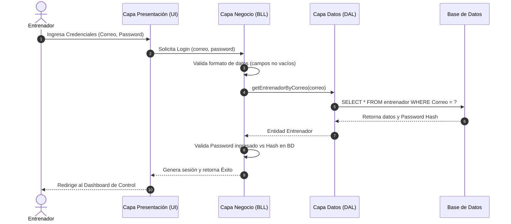

### 6.2 Diagrama de Secuencia: Crear Plan de Entrenamiento (CU06)

Este es el proceso más importante (el "Core" del negocio), donde se ensamblan múltiples componentes lógicos para asignar el plan al cliente.

```mermaid
sequenceDiagram
    autonumber
    actor E as Entrenador
    participant UI as Capa Presentación
    participant BLL as Capa Negocio
    participant DAL as Capa Datos
    participant BD as Base de Datos

    E->>UI: Selecciona Cliente, Rutina, Dieta y Fechas
    UI->>BLL: Enviar datos del Plan (cliente_id, rutina_id, dieta_id, fechas)
  
    note over BLL: Regla de Negocio: Validar fechas
    BLL->>BLL: Valida que Fecha_fin >= Fecha_inicio
  
    BLL->>DAL: validaExistencia(cliente_id, rutina_id, dieta_id)
    DAL->>BD: Ejecuta SELECT de validación
    BD-->>DAL: Confirmación de existencia (OK)
    DAL-->>BLL: True
  
    BLL->>DAL: insertPlanEntrenamiento(datos_plan)
    DAL->>BD: INSERT INTO plan_entrenamiento...
    BD-->>DAL: Retorna nuevo plan_id (Éxito)
    DAL-->>BLL: plan_id
  
    BLL-->>UI: Respuesta OK
    UI-->>E: Muestra notificación "Plan asignado correctamente"
```

### 6.3 Diagrama de Secuencia: Cliente Consulta su Plan (CU08)

Flujo de solo lectura. El cliente ingresa al sistema para visualizar la rutina que le toca realizar.

```mermaid
sequenceDiagram
    autonumber
    actor C as Cliente
    participant UI as Capa Presentación
    participant BLL as Capa Negocio
    participant DAL as Capa Datos

    C->>UI: Ingresa a la sección "Mi Plan"
    UI->>BLL: getPlanActivo(cliente_id)
    BLL->>DAL: selectPlanVigenteByCliente(cliente_id, fecha_actual)
    DAL-->>BLL: Retorna plan_id, rutina_id, dieta_id
  
    BLL->>DAL: getDetalleRutinaConEjercicios(rutina_id)
    DAL-->>BLL: Retorna lista de rutina_ejercicio
  
    BLL->>DAL: getDieta(dieta_id)
    DAL-->>BLL: Retorna detalles de la dieta
  
    BLL->>BLL: Ensambla el DTO (Objeto de Transferencia) del Plan
    BLL-->>UI: JSON con Plan Completo
    UI-->>C: Renderiza la tabla de ejercicios y vista de dieta
```

---

## FASE 7: DISEÑO DE DETALLE PROCEDIMENTAL

En esta fase se especifica el diseño detallado a nivel de código para cada Caso de Uso, mapeando exactamente las clases, atributos y métodos (con sus firmas reales) que se implementaron en la Arquitectura de 3 Capas.

#### 7.1 CU: GESTIONAR CLIENTE

El siguiente diagrama de clases muestra el flujo procedimental horizontal (Presentación -> Negocio -> Datos) extraído directamente del código fuente (`PCliente`, `NCliente.php`, `DCliente.php`).

```mermaid
classDiagram
    direction LR

    class P_Cliente {
        + crearCliente(datosCliente): Boolean
        + editarCliente(datosCliente): Boolean
        + eliminarCliente(idCliente): Boolean
        + obtenerClientes(): List~Cliente~
        + loginCliente(credenciales): Boolean
    }

    class N_Cliente {
        + crearCliente(datosCliente): Boolean
        + editarCliente(datosCliente): Boolean
        + eliminarCliente(idCliente): Boolean
        + obtenerClientes(): List~Cliente~
        + loginCliente(credenciales): Cliente
    }

    class D_Cliente {
        - dbHelper: Database
        + crearCliente(datosCliente): Boolean
        + editarCliente(datosCliente): Boolean
        + eliminarCliente(idCliente): Boolean
        + obtenerClientes(): List~Cliente~
        + buscarPorCorreo(correo): Cliente
    }

    P_Cliente --> N_Cliente
    N_Cliente --> D_Cliente
```

---

### 7.2 PROGRESO DE DIAGRAMAS PROCEDIMENTALES

| Caso de Uso                                 |    Estado    |
| :------------------------------------------ | :-----------: |
| **CU01: Gestionar Cliente**           | ✅ Completado |
| **CU07: Iniciar Sesión (Login)**     | ✅ Completado |
| **CU02: Gestionar Dieta**             | ✅ Completado |
| **CU03: Gestionar Ejercicio**         | ✅ Completado |
| **CU04: Gestionar Rutina**            | ✅ Completado |
| **CU05: Asignar Ejercicio a Rutina**  | ✅ Completado |
| **CU06: Crear Plan de Entrenamiento** | ✅ Completado |

---

### 7.3 CU: INICIAR SESIÓN (LOGIN)

El siguiente diagrama muestra el flujo de validación de credenciales para acceder al sistema. Tal como está programado en `Login.php`, la presentación delega la validación a `N_Entrenador` o `N_Cliente` dependiendo del rol seleccionado.

```mermaid
classDiagram
    direction LR

    class P_Login {
        + iniciarSesion(credenciales, rol): Boolean
        + cerrarSesion(): Boolean
    }

    class N_Entrenador {
        + validarLogin(credenciales): Entrenador
    }

    class D_Entrenador {
        - dbHelper: Database
        + buscarPorCorreo(correo): Entrenador
    }

    class N_Cliente {
        + validarLogin(credenciales): Cliente
    }

    class D_Cliente {
        - dbHelper: Database
        + buscarPorCorreo(correo): Cliente
    }

    P_Login --> N_Entrenador : rol = entrenador
    N_Entrenador --> D_Entrenador

    P_Login --> N_Cliente : rol = cliente
    N_Cliente --> D_Cliente
```

---

### 7.4 CU: GESTIONAR DIETA

```mermaid
classDiagram
    direction LR

    class P_Dieta {
        + crearDieta(datosDieta): Boolean
        + editarDieta(datosDieta): Boolean
        + eliminarDieta(idDieta): Boolean
        + obtenerDietas(): List~Dieta~
    }

    class N_Dieta {
        + crearDieta(datosDieta): Boolean
        + editarDieta(datosDieta): Boolean
        + eliminarDieta(idDieta): Boolean
        + obtenerDietas(): List~Dieta~
        + obtenerDietaPorIdCliente(idDieta): Dieta
    }

    class D_Dieta {
        - dbHelper: Database
        + crearDieta(datosDieta): Boolean
        + editarDieta(datosDieta): Boolean
        + eliminarDieta(idDieta): Boolean
        + obtenerDietas(): List~Dieta~
        + buscarDietaPorIdCliente(idDieta): Dieta
    }

    P_Dieta --> N_Dieta
    N_Dieta --> D_Dieta
```

---

### 7.5 CU: GESTIONAR EJERCICIO

```mermaid
classDiagram
    direction LR

    class P_Ejercicio {
        + crearEjercicio(datosEjercicio): Boolean
        + editarEjercicio(datosEjercicio): Boolean
        + eliminarEjercicio(idEjercicio): Boolean
        + obtenerEjercicios(): List~Ejercicio~
    }

    class N_Ejercicio {
        + crearEjercicio(datosEjercicio): Boolean
        + editarEjercicio(datosEjercicio): Boolean
        + eliminarEjercicio(idEjercicio): Boolean
        + obtenerEjercicios(): List~Ejercicio~
    }

    class D_Ejercicio {
        - dbHelper: Database
        + crearEjercicio(datosEjercicio): Boolean
        + editarEjercicio(datosEjercicio): Boolean
        + eliminarEjercicio(idEjercicio): Boolean
        + obtenerEjercicios(): List~Ejercicio~
    }

    P_Ejercicio --> N_Ejercicio
    N_Ejercicio --> D_Ejercicio
```

---

### 7.6 CU: GESTIONAR RUTINA

```mermaid
classDiagram
    direction LR

    class P_Rutina {
        + crearRutina(datosRutina): Boolean
        + editarRutina(datosRutina): Boolean
        + eliminarRutina(idRutina): Boolean
        + obtenerRutinas(): List~Rutina~
    }

    class N_Rutina {
        + crearRutina(datosRutina): Boolean
        + editarRutina(datosRutina): Boolean
        + eliminarRutina(idRutina): Boolean
        + obtenerRutinas(): List~Rutina~
    }

    class D_Rutina {
        - dbHelper: Database
        + crearRutina(datosRutina): Boolean
        + editarRutina(datosRutina): Boolean
        + eliminarRutina(idRutina): Boolean
        + obtenerRutinas(): List~Rutina~
    }

    P_Rutina --> N_Rutina
    N_Rutina --> D_Rutina
```

---

### 7.7 CU: ASIGNAR EJERCICIO A RUTINA

Este CU representa la tabla intermedia M:N entre Rutina y Ejercicio. La Presentación necesita obtener la lista de Ejercicios disponibles para asignarlos a una Rutina específica.

```mermaid
classDiagram
    direction LR

    class P_RutinaEjercicio {
        + asignarEjercicio(datosAsignacion): Boolean
        + eliminarAsignacion(idAsignacion): Boolean
        + obtenerEjerciciosPorRutina(idRutina): List~RutinaEjercicio~
        + obtenerAsignaciones(): List~RutinaEjercicio~
    }

    class N_RutinaEjercicio {
        + asignarEjercicio(datosAsignacion): Boolean
        + eliminarAsignacion(idAsignacion): Boolean
        + obtenerEjerciciosPorRutina(idRutina): List~RutinaEjercicio~
        + obtenerAsignaciones(): List~RutinaEjercicio~
    }

    class D_RutinaEjercicio {
        - dbHelper: Database
        + asignarEjercicio(datosAsignacion): Boolean
        + eliminarAsignacion(idAsignacion): Boolean
        + obtenerEjerciciosPorRutina(idRutina): List~RutinaEjercicio~
        + obtenerAsignaciones(): List~RutinaEjercicio~
    }

    class N_Ejercicio {
        + obtenerEjercicios(): List~Ejercicio~
    }

    class D_Ejercicio {
        - dbHelper: Database
        + obtenerEjercicios(): List~Ejercicio~
    }

    P_RutinaEjercicio --> N_RutinaEjercicio
    P_RutinaEjercicio --> N_Ejercicio

    N_RutinaEjercicio --> D_RutinaEjercicio
    N_Ejercicio --> D_Ejercicio
```

---

### 7.8 CU: CREAR PLAN DE ENTRENAMIENTO

Basado en el diseño complejo de Asignaciones, la creación de un Plan de Entrenamiento requiere interactuar con las lógicas de Cliente, Rutina y Dieta para obtener las listas seleccionables y luego procesar el guardado.

```mermaid
classDiagram
    direction LR

    class P_PlanEntrenamiento {
        + crearPlan(datosPlan): Boolean
        + eliminarPlan(idPlan): Boolean
        + obtenerPlanes(): List~PlanEntrenamiento~
        + cargarDatosDesplegables(): void
    }

    class N_PlanEntrenamiento {
        + crearPlan(datosPlan): Boolean
        + obtenerPlanes(idEntrenador): List~PlanEntrenamiento~
        + obtenerPlanPorId(id): PlanEntrenamiento
        + eliminarPlan(id): Boolean
        + obtenerPlanesPorCliente(idCliente): List~PlanEntrenamiento~
    }

    class D_PlanEntrenamiento {
        - dbHelper: Database
        + crearPlan(datosPlan): Boolean
        + obtenerPlanes(idEntrenador): List~PlanEntrenamiento~
        + obtenerPlanPorId(id): PlanEntrenamiento
        + eliminarPlan(id): Boolean
        + obtenerPlanesPorCliente(idCliente): List~PlanEntrenamiento~
    }

    class N_Cliente {
        + obtenerClientes(): List~Cliente~
    }

    class D_Cliente {
        - dbHelper: Database
        + findAll(): array
    }

    class N_Rutina {
        + obtenerRutinas(): List~Rutina~
    }

    class D_Rutina {
        - dbHelper: Database
        + findAll(): array
    }

    class N_Dieta {
        + obtenerDietas(): List~Dieta~
    }

    class D_Dieta {
        - dbHelper: Database
        + findAll(): array
    }

    %% Relaciones de la Capa de Presentación hacia Negocio
    P_PlanEntrenamiento --> N_PlanEntrenamiento
    P_PlanEntrenamiento --> N_Cliente
    P_PlanEntrenamiento --> N_Rutina
    P_PlanEntrenamiento --> N_Dieta

    %% Relaciones de Negocio a Datos
    N_PlanEntrenamiento --> D_PlanEntrenamiento
    N_Cliente --> D_Cliente
    N_Rutina --> D_Rutina
    N_Dieta --> D_Dieta
```
